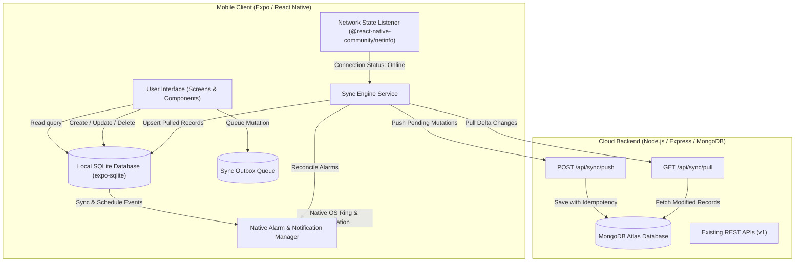

# 00. Executive Summary & Architecture Roadmap

## 1. Executive Summary

### 1.1 Context & Problem Statement
The Portfolio Admin & Personal Dashboard application (`mobile-app`) is a multi-feature system encompassing **Calendar & Event Scheduling**, **Diet & Workout Tracking**, **Finance & Budgeting**, **Investment Portfolio & Stock Analysis**, **Portfolio Management (Blogs, Projects, Skills, Photos, Contacts, Education, Social Links)**, and **AI Assistants**.

Currently, the mobile client is architected as an **online-dependent thin client**:
1. Every screen executes live `fetch()` calls to the remote backend (`CLOUD_API_URL` or local `localhost:5000`).
2. When offline or in low-connectivity environments:
   - Data loading fails, showing blank screens, infinite spinners, or network error alerts.
   - Any create, update, or delete operation (e.g. creating an urgent calendar event, logging a meal, recording an expense) fails immediately with `Network request failed` and user input is permanently lost.
   - Event reminders rely heavily on a 30-second interval polling `api.getUpcomingReminders()` over HTTP. In offline mode, this polling fails, meaning **scheduled reminders and ringing alarms do not trigger at all**.
3. Upon reconnection, there is no reconciliation between stale local state and new server state, leading to inconsistencies.

### 1.2 The Offline-First Transformation
As defined in `newFeature.md`, the objective is to transform this application into a **true offline-first, production-grade application**:
- **Zero-Internet Functionality**: The entire app must open instantly and function offline. Users can view, create, edit, and delete calendar events, meals, finance transactions, investments, and portfolio entries without an active internet connection.
- **Independent Local Notifications & Alarms**: Calendar events and meal schedules already on the device must trigger local notifications and loud ringing alarms natively via Android's AlarmManager (`SCHEDULE_EXACT_ALARM`, `RECEIVE_BOOT_COMPLETED`), without requiring any internet connection.
- **Optimistic UI with Outbox Queue**: All mutations are applied instantly to local storage (`expo-sqlite`) and placed in a persistent Outbox queue.
- **Automatic Bidirectional Synchronization**: When internet connectivity is restored, the Sync Engine automatically pushes local changes to the server, pulls server updates since the last sync, reconciles any conflicts, and updates scheduled alarms.

---

## 2. Architectural Pillars

```
┌────────────────────────────────────────────────────────────────────────┐
│                          LOCAL-FIRST ARCHITECTURE                      │
├──────────────────┬──────────────────┬──────────────────┬───────────────┤
│ 1. Local Storage │ 2. Alarm Engine  │ 3. Sync Outbox   │ 4. Optimistic │
│    Single Source │    Independent   │    Reliable Push │    UI & Zero  │
│    of Truth      │    OS Alarms     │    & Delta Pull  │    Loss UX    │
│                  │                  │                  │               │
│ • expo-sqlite    │ • expo-notif     │ • Outbox Queue   │ • Instant UI  │
│ • Full CRUD      │ • Exact Alarms   │ • UUID Client IDs│ • Sync Status │
│ • Indexed tables │ • Ring / Audio   │ • LWW Resolution │ • Retry Logic │
│ • Fast queries   │ • Reboot survive │ • Tombstones     │ • Staged Media│
└──────────────────┴──────────────────┴──────────────────┴───────────────┘
```

### Pillar 1: Local SQLite as the Single Source of Truth
The UI never reads directly from network HTTP calls. The UI reads from the local SQLite database. Network fetches populate the local database; mutations update the local database first.

### Pillar 2: Native Offline Alarm & Ringing Engine
Reminders must never depend on server polling. When an event or meal is created or pulled from sync:
- It is scheduled directly in the native device AlarmManager via `expo-notifications`.
- Configured with `importance: MAX`, custom alarm ringtones, high-priority heads-up banners, and vibration.
- Survives phone reboots through `RECEIVE_BOOT_COMPLETED` re-registration.

### Pillar 3: Resilient Bidirectional Sync Protocol
- **Client Outbox**: Every mutation (INSERT, UPDATE, DELETE) is written to a transactional `sync_outbox` table with a unique `mutation_id` (UUID).
- **Delta Sync**: The client stores `last_pulled_at`. When online, it sends pending outbox items via `POST /api/sync/push`, then fetches delta updates via `GET /api/sync/pull?since={timestamp}`.
- **Tombstones**: Soft-deletes (`isDeleted: true`) ensure deletions on one client propagate correctly to all other clients.

### Pillar 4: Graceful Degradation for Cloud-Only Features
AI features (LLM routine generation, stock analyzer, Grok cold email) inherently require cloud processing. For these:
- All historical conversations, outputs, and generated plans are stored locally and searchable offline.
- When offline, creation actions show clear, polite UI badges ("Cloud processing requires active connection") without crashing or corrupting state.
- Media uploads (e.g. blog images, photo gallery) stage photos locally in filesystem cache and upload to Cloudinary asynchronously upon reconnection.

---

## 3. High-Level System Architecture



---

## 4. Implementation Roadmap & Phases

| Phase | Title | Key Deliverables | Estimated Scope |
| :--- | :--- | :--- | :--- |
| **Phase 1** | **Foundation: Local DB & Storage Setup** | - Install `expo-sqlite` & `@react-native-community/netinfo`<br>- Build DB migration runner & schema definitions<br>- Implement DAO (Data Access Object) query layers for all models<br>- Client-side UUID generator (`crypto.randomUUID`) | Core Infra |
| **Phase 2** | **Offline Calendar & Native Alarm Engine** | - Re-architect `notificationService.js` to eliminate HTTP polling<br>- Implement Local Alarm Reconciliation Engine<br>- Setup Android exact alarm channels with sound & vibration<br>- Schedule offline meal & calendar reminders up to 30 days ahead<br>- Device reboot recovery handler | Critical User Priority |
| **Phase 3** | **Sync Engine & Outbox Architecture** | - Implement `SyncOutbox` persistent queue<br>- Implement Network Status Monitor & auto-sync trigger<br>- Build backend `/api/sync/push` and `/api/sync/pull` endpoints<br>- Add Mongoose schema fields: `clientId`, `isDeleted`, `deletedAt`, `serverUpdatedAt`<br>- Implement Last-Write-Wins (LWW) conflict resolver | Sync Infra |
| **Phase 4** | **Module-by-Module Offline Adaptation** | - Adapt Calendar & Routine screens<br>- Adapt Workout & Diet screens (offline items, daily logs, visuals)<br>- Adapt Finance & Budget screens (offline transaction logging)<br>- Adapt Investment screens (offline holdings & transactions)<br>- Adapt Portfolio Admin (Blogs, Projects, Skills, Gallery, Education, Contacts)<br>- Staged media upload manager (Cloudinary background sync) | Feature Migration |
| **Phase 5** | **Offline UI/UX Polish & AI Graceful Handling** | - Online/Offline status banner and sync pulse pill<br>- Pending sync badge counters on list items<br>- AI offline state banners with cached chat history<br>- Manual "Pull to Refresh" sync trigger and error retry toasts | Frontend Polish |
| **Phase 6** | **Testing, Verification & Hardening** | - Airplane mode end-to-end tests<br>- Intermittent network & retry backoff tests<br>- Cold restart & device reboot alarm firing tests<br>- Multi-client conflict resolution tests<br>- Production EAS build & APK verification | QA & Release |

---

## 5. Success Criteria
1. **100% Offline Navigation**: The app opens instantaneously from cold start in Airplane mode and all past data across all tabs is accessible without error screens.
2. **Offline Data Creation**: A user can add a calendar event, log an expense, or tick off a meal in airplane mode, restart the app, and see their data intact.
3. **Guaranteed Local Ringing**: Calendar reminders and diet alarms ring loudly at the exact scheduled minute on Android, with zero internet connection, even if the app was closed.
4. **Zero Data Loss on Reconnect**: Connecting to Wi-Fi immediately flushes all outbox mutations to MongoDB, pulls any updates from other devices, and clears the outbox cleanly.

