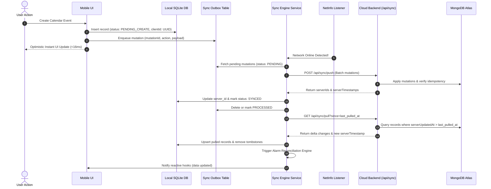
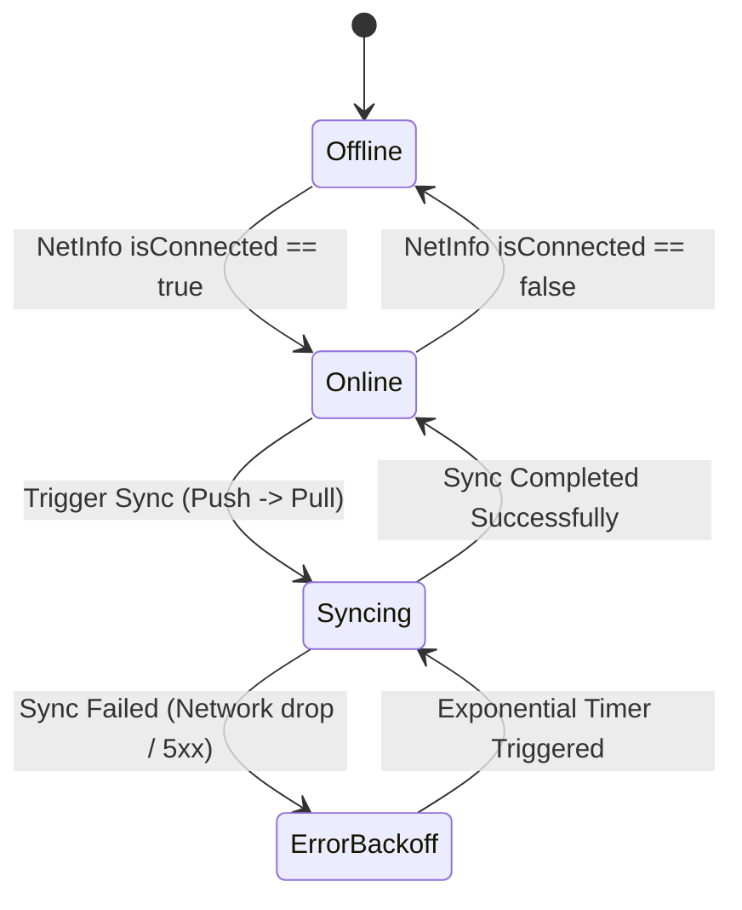

# 03. Sync Engine & Protocol Specification

## 1. Overview & Sync Lifecycle

The Sync Engine is the central nervous system connecting the local SQLite database to the remote MongoDB Atlas backend. It employs an **Outbox Pattern** paired with **Delta Synchronization (Incremental Cursor Sync)** to guarantee consistency, idempotency, and zero data loss.



---

## 2. The Transactional Outbox Pattern

Every mutation that alters data (Create, Update, Delete) is written inside an **ACID SQLite transaction** along with an outbox record.

```javascript
// Example: Transactional save in local SQLite
await db.withTransactionAsync(async () => {
  // 1. Write the entity record locally
  await db.runAsync(
    `INSERT INTO calendar_events (client_id, title, start_at, end_at, sync_status, created_at, updated_at)
     VALUES (?, ?, ?, ?, 'PENDING_CREATE', ?, ?)`,
    [clientId, title, startAt, endAt, now, now]
  );

  // 2. Write the outbox queue entry
  await db.runAsync(
    `INSERT INTO sync_outbox (mutation_id, entity_name, action, client_id, payload, status, created_at, updated_at)
     VALUES (?, 'calendar_event', 'CREATE', ?, ?, 'PENDING', ?, ?)`,
    [mutationId, clientId, JSON.stringify(payload), now, now]
  );
});
```

### 2.1 Outbox Mutation Lifecycle
- `PENDING`: Initial state upon creation.
- `PROCESSING`: Currently sent over the wire; locked to prevent duplicate requests.
- `COMPLETED`: Acknowledged by backend. Record is deleted from outbox or marked archived.
- `FAILED`: Network or validation error. Retry counter incremented with exponential backoff:
  $$\text{Delay} = \min(2^{\text{retry\_count}} \times 1000\,\text{ms}, 60000\,\text{ms})$$

---

## 3. Backend Synchronization API Specifications

### 3.1 Push Endpoint: `POST /api/sync/push`

Accepts a batch of pending mutations from the client and applies them atomically or sequentially with idempotency guards.

#### Request Headers
```http
POST /api/sync/push HTTP/1.1
Content-Type: application/json
Authorization: Bearer <jwt_or_user_session>
```

#### Request Payload
```json
{
  "clientId": "device_pixel_8a_9921",
  "mutations": [
    {
      "mutationId": "b3e34a60-9b48-4fd7-938b-d72b22ecdf56",
      "entity": "calendar_event",
      "action": "CREATE",
      "clientId": "a1f592c0-82a1-42ec-b3e1-cf24d1a0172e",
      "payload": {
        "title": "Strategy Sync Meeting",
        "description": "Discuss Q4 portfolio expansion",
        "calendarId": "651a2f90184b23c218d098e1",
        "startAt": "2026-11-06T10:00:00.000Z",
        "endAt": "2026-11-06T11:00:00.000Z",
        "isAllDay": false,
        "priority": "high",
        "reminders": [{ "offsetMinutes": 15, "isEnabled": true }]
      },
      "clientTimestamp": "2026-11-05T21:55:00.000Z"
    },
    {
      "mutationId": "f7d23a10-21a4-4ca8-89c2-b5e192ecae12",
      "entity": "finance_transaction",
      "action": "CREATE",
      "clientId": "c2b189a0-98d1-4e12-881b-a912e5e1c019",
      "payload": {
        "type": "expense",
        "amount": 250,
        "category": "Food",
        "description": "Lunch meeting",
        "date": "2026-11-05T13:00:00.000Z",
        "paymentMethod": "UPI"
      },
      "clientTimestamp": "2026-11-05T21:55:10.000Z"
    }
  ]
}
```

#### Response Payload (`200 OK`)
```json
{
  "success": true,
  "results": [
    {
      "mutationId": "b3e34a60-9b48-4fd7-938b-d72b22ecdf56",
      "clientId": "a1f592c0-82a1-42ec-b3e1-cf24d1a0172e",
      "serverId": "6724a1b0294c71e48102a11b",
      "status": "applied",
      "serverUpdatedAt": "2026-11-05T21:55:01.210Z"
    },
    {
      "mutationId": "f7d23a10-21a4-4ca8-89c2-b5e192ecae12",
      "clientId": "c2b189a0-98d1-4e12-881b-a912e5e1c019",
      "serverId": "6724a1b0294c71e48102a11c",
      "status": "applied",
      "serverUpdatedAt": "2026-11-05T21:55:01.320Z"
    }
  ],
  "serverTime": "2026-11-05T21:55:01.500Z"
}
```

---

### 3.2 Pull Endpoint: `GET /api/sync/pull`

Returns all entities modified, created, or soft-deleted since the specified timestamp cursor.

#### Request
```http
GET /api/sync/pull?since=2026-11-05T20:00:00.000Z&userId=admin HTTP/1.1
Authorization: Bearer <jwt_or_user_session>
```

#### Response Payload (`200 OK`)
```json
{
  "serverTime": "2026-11-05T21:55:02.000Z",
  "changes": {
    "calendars": [],
    "calendarEvents": [
      {
        "_id": "6724a1b0294c71e48102a11b",
        "clientId": "a1f592c0-82a1-42ec-b3e1-cf24d1a0172e",
        "title": "Strategy Sync Meeting",
        "startAt": "2026-11-06T10:00:00.000Z",
        "endAt": "2026-11-06T11:00:00.000Z",
        "status": "scheduled",
        "reminders": [{ "offsetMinutes": 15, "isEnabled": true }],
        "isDeleted": false,
        "serverUpdatedAt": "2026-11-05T21:55:01.210Z"
      },
      {
        "_id": "651a2f90184b23c218d09999",
        "clientId": "f90184b2-23c2-18d0-9999-a1b2c3d4e5f6",
        "isDeleted": true,
        "deletedAt": "2026-11-05T21:40:00.000Z",
        "serverUpdatedAt": "2026-11-05T21:40:01.000Z"
      }
    ],
    "dietItems": [],
    "dietMealLogs": [],
    "financeTransactions": [],
    "investmentHoldings": [],
    "portfolioBlogs": []
  }
}
```

---

## 4. Conflict Resolution: Last-Write-Wins (LWW)

In a single-user or small-team personal dashboard, the deterministic and industry-standard strategy is **Last-Write-Wins (LWW)** governed by monotonic server timestamps.

```
┌────────────────────────────────────────────────────────┐
│               CONFLICT RESOLUTION MATRIX               │
├───────────────────┬───────────────────┬────────────────┤
│ Client State      │ Server State      │ Winner         │
├───────────────────┼───────────────────┼────────────────┤
│ Edited at T1      │ Edited at T2 (T2>T1)│ Server Record  │
│ Edited at T2      │ Edited at T1 (T2>T1)│ Client Record  │
│ Edited at T1      │ Deleted at T2     │ Tombstone (Del)│
│ Deleted at T1     │ Edited at T2 (T2>T1)│ Edit Wins      │
└───────────────────┴───────────────────┴────────────────┘
```

### 4.1 Tombstones (Soft Deletes)
Hard deletes (`Model.deleteOne()`) break offline sync because other devices have no record that a deletion happened. 
- In MongoDB, all collections receive `isDeleted: { type: Boolean, default: false, index: true }` and `deletedAt: { type: Date, default: null }`.
- In SQLite, the corresponding row has `is_deleted = 1`.
- When pulling delta changes, rows with `isDeleted: true` trigger a local SQLite update setting `is_deleted = 1` or cascading deletion of dependent reminders.

---

## 5. Network Lifecycle & Trigger Management

The Sync Engine utilizes `@react-native-community/netinfo` to observe network reachability and triggers synchronization automatically:



### 5.1 Sync Triggers
1. **Network Reconnection**: Whenever NetInfo reports transition to connected.
2. **App Foregrounding**: `AppState.addEventListener('change', state => state === 'active')`.
3. **Optimistic Outbox Push**: Debounced 1500ms trigger whenever a new mutation is enqueued (if already online).
4. **Manual User Refresh**: "Pull to refresh" on Calendar, Diet, Finance, and Investment screens.

---

## 6. Next Steps
With the sync protocol established, the next document (**[04_OFFLINE_CALENDAR_AND_LOCAL_ALARM_ENGINE.md](./04_OFFLINE_CALENDAR_AND_LOCAL_ALARM_ENGINE.md)**) solves the primary pain point from `newFeature.md`: **offline calendar notifications, alarms, and ringing**.

