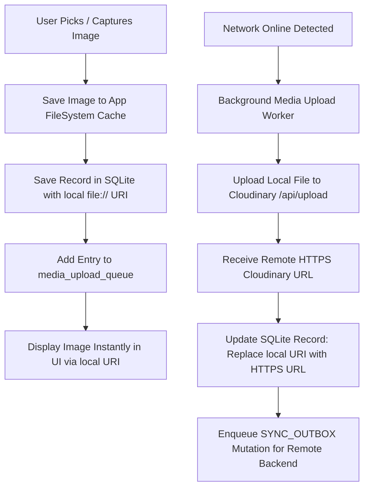

# 05. Module-by-Module Offline Implementation Specs

## 1. Authentication & Session Module

### 1.1 Objective
Ensure that once a user logs in, they are never locked out of the app when operating in environments without cell reception or Wi-Fi.

### 1.2 Architecture & Flow
1. **Persistent Session**:
   - `AUTH_USER` token and profile payload are securely cached in `AsyncStorage`.
   - `App.js` checks `AsyncStorage.getItem('AUTH_USER')` during initial startup. If valid, the user enters `DashboardScreen` immediately without making any blocking HTTP requests.
2. **Offline Grace Period**:
   - Network failure (`TypeError: Network request failed`) during any API call will **never** trigger automatic logout or route change.
   - The session remains active indefinitely offline.
3. **Offline Auth Screen Fallback**:
   - If a user opens the app while logged out and offline, the Auth Screen displays an informative banner:
     > *"You are currently offline. Connect to the internet once to authenticate your account."*
   - Optional PIN / Biometric unlock can be added for fast local authentication.

---

## 2. Calendar & Scheduling Module

### 2.1 File Targets
- `mobile-app/src/screens/calendar/CalendarScreen.js`
- `mobile-app/src/screens/calendar/components/CalendarViews.js`
- `mobile-app/src/screens/calendar/components/CalendarModals.js`
- `mobile-app/src/screens/calendar/components/AiRoutinePlannerModal.js`
- `mobile-app/src/db/dao/CalendarDao.js`

### 2.2 Offline Behavior & Data Flow
1. **Reading Data**:
   - `loadData()` reads directly from local SQLite (`CalendarDao.getCalendars()` and `CalendarDao.getEventsInRange(start, end)`).
   - Instant loading with **zero network spinner**.
2. **Creating & Updating Events**:
   - `handleSaveEvent()` generates a UUID `client_id = crypto.randomUUID()`.
   - Writes event to SQLite inside a transaction.
   - For each configured reminder (e.g. 15m, 0m), creates an entry in `event_reminders`.
   - Immediately calls `reconcileAlarms()` to register the native OS alarm in `expo-notifications`.
   - Enqueues mutation into `sync_outbox`.
   - Updates local UI state immediately.
3. **Deleting Events**:
   - Soft-deletes locally: sets `is_deleted = 1` in SQLite.
   - Cancels native OS scheduled notification.
   - Enqueues `DELETE` mutation in `sync_outbox`.
4. **AI Routine Planner Offline Handling**:
   - If user attempts AI generation offline: Modal displays:
     > *"AI Routine Generation requires an active internet connection. Please connect to Wi-Fi/data to generate custom schedules."*
   - Past AI routine plans (`CalendarAiPlan`) remain cached in local SQLite for review and manual acceptance.

---

## 3. Workout & Diet Management Module

### 3.1 File Targets
- `mobile-app/src/screens/workout/WorkoutDietScreen.js`
- `mobile-app/src/screens/workout/components/TodaysDietPlanTab.js`
- `mobile-app/src/screens/workout/components/DietLibraryTab.js`
- `mobile-app/src/screens/workout/components/ScheduleMealModal.js`
- `mobile-app/src/screens/workout/components/DietCaloriesVisuals.js`
- `mobile-app/src/db/dao/DietDao.js`

### 3.2 Offline Behavior & Data Flow
1. **Daily Meal Plan**:
   - Queries `diet_meal_logs` table for `date = ?`.
   - Instant rendering of Breakfast, Lunch, Snack, and Dinner items.
2. **Toggling Meal Status (Eaten / Pending)**:
   - User taps the status checkbox when eating a meal.
   - Status updates in local SQLite immediately (`UPDATE diet_meal_logs SET status = ? WHERE client_id = ?`).
   - If meal has a linked calendar reminder, the reminder is marked completed or dismissed.
   - Mutation queued in `sync_outbox`.
3. **Diet Library & Ingredient Breakdown**:
   - Food database (items, calories, macros, ingredient breakdown) lives in local SQLite table `diet_items`.
   - User can search and filter the diet library completely offline.
   - Tapping the "i" button on any food item calculates macro/calorie breakdown instantly in JavaScript using the stored JSON `ingredients` column—**zero server API required**.
4. **Diet Calories Visuals**:
   - Past 7/14/30 day calorie consumption charts are computed by running a local SQL aggregate:
     ```sql
     SELECT date, SUM(calories) as total_calories 
     FROM diet_meal_logs 
     WHERE status = 'eaten' AND date >= ? AND date <= ?
     GROUP BY date ORDER BY date ASC;
     ```
   - Chart renders instantly with offline historical data.

---

## 4. Finance & Expense Management Module

### 4.1 File Targets
- `mobile-app/src/screens/finance/FinanceScreen.js`
- `mobile-app/src/db/dao/FinanceDao.js`

### 4.2 Offline Behavior & Data Flow
1. **Instant Expense Logging**:
   - The user pays cash or makes an offline purchase.
   - Enters Amount, Category, Description, and Payment Method.
   - Saves to `finance_transactions` locally within 10ms.
   - Enqueues mutation to `sync_outbox`.
2. **Real-time Financial Summaries**:
   - The top summary cards (Total Income, Total Expense, Net Balance, Budget Utilization) are computed on-device via local SQLite:
     ```sql
     SELECT 
       SUM(CASE WHEN type = 'income' THEN amount ELSE 0 END) as total_income,
       SUM(CASE WHEN type = 'expense' THEN amount ELSE 0 END) as total_expense
     FROM finance_transactions 
     WHERE month = ? AND is_deleted = 0;
     ```
   - No waiting for `/api/finance/summary` HTTP response.
3. **Monthly Budget Tracking**:
   - Category budget limits stored in `finance_budgets` are compared against local monthly totals to compute budget progress bars offline.

---

## 5. Investment & Wealth Management Module

### 5.1 File Targets
- `mobile-app/src/screens/finance/InvestmentScreen.js`
- `mobile-app/src/screens/finance/InvestmentAnalyticsScreen.js`
- `mobile-app/src/screens/finance/PortfolioInsightsScreen.js`
- `mobile-app/src/db/dao/InvestmentDao.js`

### 5.2 Offline Behavior & Data Flow
1. **Holdings & Net Worth**:
   - Displays all stored holdings from `investment_holdings`.
   - Portfolio valuation uses `last_known_price`.
   - The UI displays an explicit timestamp: *"Valuation as of last online sync: Nov 5, 2026, 09:30 PM"*.
2. **Logging Buy / Sell Trades Offline**:
   - User inputs trade (Symbol, Quantity, Price, Date).
   - Local SQLite transaction updates holding quantity, recalculates average purchase price, and inserts record into `investment_transactions`.
   - Outbox mutation queued for push upon reconnection.
3. **AI Stock Analyzer & Chat**:
   - Past stock analysis sessions (`AiStockChat`) are cached in SQLite for offline reading.
   - Real-time stock quote lookups and AI generation disable gracefully with an offline alert.

---

## 6. Portfolio Admin (Blogs, Projects, Skills, Gallery, Education, Social, Contacts)

### 6.1 File Targets
- `mobile-app/src/screens/portfolio/*`
- `mobile-app/src/db/dao/PortfolioDao.js`

### 6.2 Offline Behavior & Data Flow
1. **Offline Drafting**:
   - Users can draft long blogs or add project portfolios while traveling.
   - Data is stored in `portfolio_blogs` and `portfolio_projects`.
   - Supports switching status between `draft` and `publish`.
2. **Contacts / Inquiries**:
   - All inbound inquiries submitted via portfolio website are downloaded during sync and readable offline.

---

## 7. Staged Media & Image Upload Architecture

Image uploads are a primary point of failure when network drops.



### 7.1 Media Storage Directory
- Staged images are saved in `FileSystem.documentDirectory + 'staged_media/'`.
- Local URIs (`file:///data/user/0/.../staged_media/img_123.jpg`) load instantly in React Native `<Image source={{ uri }} />`.
- Once uploaded to Cloudinary, the local cache is pruned to save device disk space.

---

## 8. Next Steps
With the client-side modules specified, the next document (**[06_BACKEND_MODIFICATIONS_AND_SCHEMA_MIGRATIONS.md](./06_BACKEND_MODIFICATIONS_AND_SCHEMA_MIGRATIONS.md)**) covers all required backend Mongoose schema updates, sync controllers, and route handlers.

