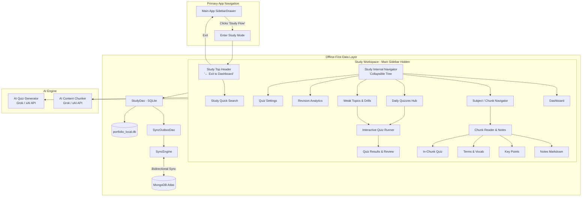

# Master Plan & Architecture: Smart Study Flow Integration

## 1. Executive Summary

This document specifies the complete, high-fidelity integration of **Smart Study Flow (SSC Smart Notes & Study Flow)** from `smart-study-flow` into the primary unified application (`mobile-app` in `Portfolio-Backend`).

The goal is to **exactly replicate** every workable feature, user experience, and component from `smart-study-flow` while maintaining:
1. **Zero UI/UX Regressions**: Preserving the exact layout, interactive workflows, component states, and user journeys.
2. **Selective Aesthetic Polish**: Harmonious theme coloring tailored to the unified portfolio app (modern deep violet/indigo gradients with refined card elevation), without altering component structures.
3. **Strict Exclusions**: Exclude the standalone landing page (`/`) and standalone auth flows (`/auth`), utilizing the primary app's existing authentication, profile, and user session context.
4. **Full-Screen Navigation Isolation**:
   - Sidebar item in the main app: **"Study Flow"** (with book/school icon).
   - Upon clicking "Study Flow", the main application's sidebar is **completely hidden**.
   - A dedicated **"← Exit to Dashboard" / "← Back"** button is surfaced prominently in the Study header to return to the home screen.
   - The Study workspace provides its own internal, collapsible study navigator (Subjects, Chunks, Daily Quizzes, Settings).
5. **100% Offline-First Architecture**: Every note, subject, chunk, quiz question, and attempt is backed by SQLite (`expo-sqlite`) locally, persisted with `SyncOutboxDao`, and synchronized bidirectionally with MongoDB Atlas when online.

---

## 2. Source System Inventory (`smart-study-flow`)

| Feature Area | Source Components / Routes | Functional Scope |
| :--- | :--- | :--- |
| **Study Dashboard** | `routes/dashboard.tsx` | Hero banner (AI organizer call-to-action), 4 statistical metric cards, "Recently updated" chunk grid cards, quick-action dialog triggers. |
| **Hierarchical Navigator** | `components/Sidebar.tsx` | Nested tree: Subjects → Parent Chunks → Leaf Sub-chunks. Reorder, add subject, add sub-chunk, delete subject/chunk, active chunk auto-scroll. |
| **Chunk Detail Reader** | `routes/chunk.$chunkId.tsx` | Dynamic breadcrumbs, in-place title/summary/notes editor, "Mark as Revised" toggle, Next Chunk navigation, Tabs: **Notes** (Markdown with GFM), **Key Points**, **Terms**, **Quiz**. |
| **AI Content Chunker** | `components/AddContentDialog.tsx`, `supabase/functions/chunk-content` | Paste ChatGPT conversations/raw text, target selector (Auto / Existing Subject / Sub-chunk), AI parsing preserving 95%+ verbatim content, JSON preview tree, manual chunk creator. |
| **Daily Quiz Hub** | `components/DailyQuizPage.tsx`, `routes/daily-quiz.tsx` | Streak tracker (flame counter, best streak), subject quiz cards with difficulty badges, 7-day stats, unattempted/completed tabs. |
| **Interactive Quiz Runner** | `components/DailyQuizContainer.tsx`, `routes/daily-quiz.$subjectId.tsx` | Configurable countdown timer, visual question navigation palette (answered, flagged, unvisited), radio option selector, question flagging, submission modal. |
| **Quiz Results & Review** | `components/DailyQuizResultPage.tsx` | Score hero banner with dynamic grade badges (A+, A, B, C, D), percentage circle/bar, Time taken, detailed question-by-question review with explanations. |
| **Quiz Settings** | `components/DailyQuizSettingsPage.tsx` | Daily quiz enable/disable, schedule time (e.g. 12:00 PM IST), difficulty level (easy, medium, hard, mixed), question count slider/input. |
| **Weak Topics Drill** | `components/WeakTopicsPage.tsx` | Tracks questions answered incorrectly, grouped by subject, "Start Drill" generates an instant 20-question custom quiz of missed topics, "Mark as Mastered". |
| **Revision Analytics** | `components/RevisionReportPage.tsx` | Retention metrics, subject-by-subject accuracy bars, active weak items vs mastered items breakdown. |
| **Global Study Search** | `routes/search.tsx` | Real-time text search across titles, summaries, notes, keypoints, terms, questions, and subject names with highlighted match results. |

---

## 3. High-Level Architecture Diagram

---

## 4. Key Design Decisions

### 4.1. Navigation Isolation Pattern
- In `mobile-app/App.js`, when `currentScreen === 'Study'`, the outer `SidebarDrawer` is conditionally bypassed.
- The root view renders `<StudyWorkspaceScreen onExit={() => setCurrentScreen('Dashboard')} />`.
- This gives the study environment maximum screen real estate (distraction-free study mode), while preserving a single-tap route back to the main app dashboard.

### 4.2. Dual Storage & Synchronization
- Local SQLite schema mirrors the PostgreSQL/Supabase schema from `smart-study-flow`.
- Primary keys use client UUIDs with server ObjectIds bridged dynamically (identical to the successful pattern established in Calendar, Diet, and Notes modules).
- Full offline functionality: users can read notes, solve quizzes, review weak topics, and create content even without active internet connectivity.

### 4.3. AI Processing Pipeline
- Instead of requiring an external Supabase Edge Function with Lovable API keys, the backend uses the existing `GROK_API_KEY` and Grok model already configured in `.env`.
- The exact prompt engineering, tool-calling JSON schema, and content preservation rules from `chunk-content/index.ts` are ported to `mobile-app/server/services/studyAiChunkerService.js`.

