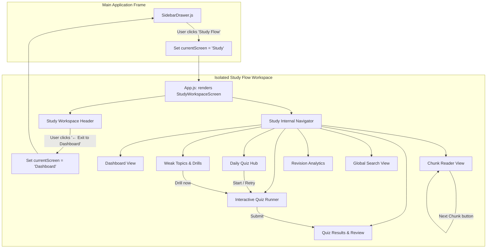

# Navigation Isolation and Layout Flow Specification: Smart Study Flow

## 1. Core Isolation Requirements

The user explicitly requested:
> *"side bar par ek study ka options rakh de . and jese hi ispe click kare tab tab apne app ka sider bar yaha appear hi nahi hna chhiaye bas back jane ka ek button de dena jisse home page par ja sake ."*

This mandates a **dedicated study workspace mode**:
1. **Entry Point**: A top-level item in the main `SidebarDrawer.js` labeled **"Study Flow"** (icon: `BookOpen` or `School`).
2. **Main Sidebar Suppression**: When `currentScreen === 'Study'`, the outer `SidebarDrawer` is completely unmounted or bypassed. The entire screen real estate is given to the Study workspace.
3. **Exit Route**: A permanent, prominent **"← Exit to Dashboard"** button is pinned at the top-left of the Study workspace header. Tapping it switches `currentScreen` back to `'Dashboard'`.
4. **Internal Navigation**: The Study workspace possesses its own autonomous, hierarchical navigation system (Subjects, Chunks, Daily Quizzes, Quiz Settings) without interfering with the primary app's routes.

---

## 2. Navigation Architecture Diagram



---

## 3. Top-Level State & View Switching (`App.js`)

In `mobile-app/App.js`:

```javascript
// Screen state
const [currentScreen, setCurrentScreen] = useState('Dashboard'); // 'Dashboard', 'Calendar', 'Notes', 'Study', etc.

// When currentScreen === 'Study', bypass main SidebarDrawer entirely
if (currentScreen === 'Study') {
  return (
    <SafeAreaView style={styles.rootContainer}>
      <StudyWorkspaceScreen
        user={user}
        onExit={() => setCurrentScreen('Dashboard')}
      />
    </SafeAreaView>
  );
}

// Normal application flow with SidebarDrawer
return (
  <SidebarDrawer
    currentScreen={currentScreen}
    onSelectScreen={setCurrentScreen}
    ...
  >
    {renderScreen()}
  </SidebarDrawer>
);
```

---

## 4. Internal Study Workspace State Machine

Within `StudyWorkspaceScreen.js`, internal view routing is managed through a lightweight, responsive view stack:

```javascript
const [studyView, setStudyView] = useState({
  screen: 'dashboard', // 'dashboard' | 'chunk' | 'quiz_hub' | 'quiz_runner' | 'quiz_result' | 'weak_topics' | 'revision' | 'search' | 'quiz_settings'
  params: {}           // e.g. { chunkId: '...', subjectId: '...', quizId: '...', attemptId: '...' }
});
```

### Internal Route Actions:
- `navigateToDashboard()`: `setStudyView({ screen: 'dashboard', params: {} })`
- `navigateToChunk(chunkId)`: `setStudyView({ screen: 'chunk', params: { chunkId } })`
- `navigateToQuizHub()`: `setStudyView({ screen: 'quiz_hub', params: {} })`
- `startQuiz(subjectId, quizId, timer)`: `setStudyView({ screen: 'quiz_runner', params: { subjectId, quizId, timer } })`
- `viewQuizResult(attemptId)`: `setStudyView({ screen: 'quiz_result', params: { attemptId } })`
- `navigateToWeakTopics()`: `setStudyView({ screen: 'weak_topics', params: {} })`
- `navigateToRevision()`: `setStudyView({ screen: 'revision', params: {} })`
- `navigateToQuizSettings()`: `setStudyView({ screen: 'quiz_settings', params: {} })`
- `openSearch(query)`: `setStudyView({ screen: 'search', params: { q: query } })`

---

## 5. Responsive Layout Specifications

### 5.1. Desktop & Tablet View (`width >= 768px`)
- **Header**:
  - Pinned top bar (height: 56px, dark background with subtle border).
  - Left: `[← Exit to Dashboard]` button with arrow icon.
  - Middle: Subject & chunk breadcrumbs.
  - Right: Quick search input box and `+ Add content` shortcut.
- **Two-Column Split Layout**:
  - **Left Sidebar** (`w-72` / 288px width):
    - Fixed position on left.
    - App title badge (`SSC Smart Notes`).
    - Action buttons: `[+ Add content]`, `[+ Add subject]`.
    - Navigation links: `⚡ Daily Quizzes`, `⚙️ Quiz Settings`.
    - Collapsible Subject tree with nested chunks and sub-chunks.
    - Item click loads chunk in main area; auto-scrolls to active item.
  - **Right Content Area** (flex: 1, scrollable):
    - Renders the active study view component.

### 5.2. Mobile View (`width < 768px`)
- **Header**:
  - Left: `[← Exit]` icon button.
  - Middle: `SSC Smart Notes` title.
  - Right: Search icon + Hamburger menu icon `[☰]`.
- **Drawer**:
  - Tapping `[☰]` opens a slide-over modal containing the Study tree navigator.
  - Selecting any chunk or quiz route automatically closes the drawer and renders the view.
- **Quiz Runner**:
  - Top bar remains sticky with countdown timer and progress indicator.
  - Question palette available as a horizontally scrollable strip or expandable sheet.
  - Bottom sticky bar for `[Submit Quiz]` so users can finish anytime without scrolling to bottom.

