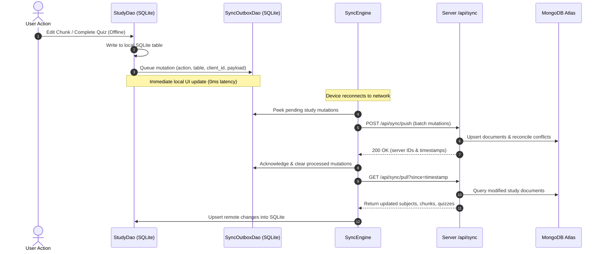

# Offline Sync and Reconciliation Specification: Smart Study Flow

## 1. Offline Philosophy & Guarantee

In accordance with the project's offline requirement:
> *"make sure ki ye jab internet na ho tab bhi work kare jese baki ke features work karte he"*

Every feature of Smart Study Flow must work seamlessly without internet:
- **Full Reading**: All notes, markdown tables, summaries, key points, and terms are stored locally in SQLite (`portfolio_local.db`).
- **Full In-Place Editing**: Creating subjects, editing chunk titles, summaries, notes, key points, terms, and toggling revised status updates SQLite immediately.
- **Offline Quiz Execution**: Daily quizzes and chunk quizzes can be attempted, timed, scored, and reviewed offline.
- **Offline Streak & Weak Questions**: Wrong answers increment mistake counters and update streak calculations locally.
- **Automatic Sync on Reconnect**: Mutations queued in `sync_outbox` are processed by `SyncEngine` as soon as connectivity resumes.

---

## 2. Data Flow Architecture



---

## 3. Data Access Object (`StudyDao.js`) Methods

`mobile-app/src/db/StudyDao.js` provides atomic operations over SQLite:

| Method Name | Parameters | Description |
| :--- | :--- | :--- |
| `getAllSubjects()` | `()` | Returns all non-deleted subjects ordered by `order_index`. |
| `createSubject()` | `(name, description)` | Inserts new subject with UUID; queues `CREATE` mutation. |
| `updateSubject()` | `(id, patch)` | Updates subject name/description; queues `UPDATE` mutation. |
| `deleteSubject()` | `(id)` | Marks `is_deleted = 1` and all child chunks; queues `DELETE` mutation. |
| `getAllChunks()` | `()` | Returns all chunks with JSON-parsed `keyPoints`, `terms`, and `quiz`. |
| `getChunkById()` | `(id)` | Returns single chunk with full details. |
| `createChunk()` | `(chunkData)` | Inserts chunk, parses arrays, queues `CREATE` mutation. |
| `updateChunk()` | `(id, patch)` | Updates fields (`title`, `notes`, `revised`, etc.); queues `UPDATE`. |
| `deleteChunk()` | `(id)` | Sets `is_deleted = 1` for chunk and its children; queues `DELETE`. |
| `getDailyQuizzes()` | `(date)` | Returns quizzes for given date. |
| `saveDailyQuiz()` | `(quizData)` | Saves generated quiz locally and in outbox. |
| `recordQuizAttempt()` | `(attemptData)` | Saves attempt, calculates score, updates streaks & weak questions atomically. |
| `getWeakQuestions()` | `(subjectId, mastered)` | Returns unmastered or mastered weak questions sorted by `times_wrong`. |
| `markWeakMastered()` | `(id)` | Marks question as mastered (`mastered = 1`). |
| `getUserStreak()` | `()` | Returns current and longest streak from SQLite. |
| `getRevisionStats()` | `()` | Aggregates accuracy, total attempts, and subject performance directly from SQLite. |

---

## 4. Offline Quiz Scoring & Weak Progress Logic

When the user finishes a quiz offline, `recordQuizAttempt` executes locally inside an SQLite transaction:

```javascript
export async function recordQuizAttemptLocally(attempt) {
  const db = await getDb();
  await db.withTransactionAsync(async () => {
    // 1. Insert Attempt
    await db.runAsync(
      `INSERT INTO study_daily_quiz_attempts (
        id, daily_quiz_id, subject_id, quiz_date, answers, score, 
        total_questions, percentage, time_taken, completed, started_at, completed_at, 
        created_at, updated_at, sync_status
      ) VALUES (?, ?, ?, ?, ?, ?, ?, ?, ?, 1, ?, ?, ?, ?, 'pending')`,
      [
        attempt.id, attempt.dailyQuizId, attempt.subjectId, attempt.quizDate,
        JSON.stringify(attempt.answers), attempt.score, attempt.totalQuestions,
        attempt.percentage, attempt.timeTaken, attempt.startedAt, attempt.completedAt,
        Date.now(), Date.now()
      ]
    );

    // 2. Queue mutation
    await SyncOutboxDao.enqueue('CREATE', 'study_daily_quiz_attempts', attempt.id, attempt);

    // 3. Update Weak Questions
    const nowIso = new Date().toISOString();
    for (const ans of attempt.answers) {
      const q = attempt.questions[ans.questionIdx];
      const hash = questionHash(q);

      if (!ans.isCorrect && ans.selectedAnswer) {
        // Wrong answer -> increment times_wrong, un-master
        await db.runAsync(
          `INSERT INTO study_weak_questions (
            id, subject_id, question_hash, question, options, answer, explanation,
            times_wrong, times_correct, mastered, last_wrong_at, last_seen_at,
            created_at, updated_at, sync_status
          ) VALUES (?, ?, ?, ?, ?, ?, ?, 1, 0, 0, ?, ?, ?, ?, 'pending')
          ON CONFLICT(subject_id, question_hash) DO UPDATE SET
            times_wrong = times_wrong + 1,
            mastered = 0,
            last_wrong_at = excluded.last_wrong_at,
            last_seen_at = excluded.last_seen_at,
            updated_at = excluded.updated_at,
            sync_status = 'pending'`,
          [
            generateUuid(), attempt.subjectId, hash, q.question, JSON.stringify(q.options),
            q.answer, q.explanation || '', nowIso, nowIso, Date.now(), Date.now()
          ]
        );
      } else if (ans.isCorrect && ans.selectedAnswer) {
        // Correct answer -> increment times_correct, mark mastered if >= 2
        await db.runAsync(
          `UPDATE study_weak_questions SET
            times_correct = times_correct + 1,
            mastered = CASE WHEN times_correct + 1 >= 2 THEN 1 ELSE mastered END,
            last_seen_at = ?,
            updated_at = ?,
            sync_status = 'pending'
          WHERE subject_id = ? AND question_hash = ?`,
          [nowIso, Date.now(), attempt.subjectId, hash]
        );
      }
    }

    // 4. Update Streak
    await updateStreakLocally(attempt.quizDate);
  });
}
```

---

## 5. Bidirectional Sync API Extensions

### 5.1. Push Mutations (`POST /api/sync/push`)
The server's existing sync route (`mobile-app/server/routes/sync.js`) is extended to process study table entities:
- `study_subjects` -> maps to `StudySubject` model.
- `study_chunks` -> maps to `StudyChunk` model.
- `study_quiz_questions` -> maps to `StudyQuizQuestion` model.
- `study_daily_quizzes` -> maps to `StudyDailyQuiz` model.
- `study_daily_quiz_attempts` -> maps to `StudyDailyQuizAttempt` model.
- `study_weak_questions` -> maps to `StudyWeakQuestion` model.
- `study_user_streaks` -> maps to `StudyUserStreak` model.

### 5.2. Pull Changes (`GET /api/sync/pull`)
Returns all study items updated since `lastPulledAt`:
```json
{
  "studySubjects": [...],
  "studyChunks": [...],
  "studyQuizQuestions": [...],
  "studyDailyQuizzes": [...],
  "studyDailyQuizAttempts": [...],
  "studyWeakQuestions": [...],
  "studyUserStreaks": [...]
}
```

### 5.3. Conflict Reconciliation Rules
1. **Timestamp Arbitration**: If an entity was updated both on client and server while offline, the record with the newer `updated_at` wins.
2. **Deletion Dominance**: If either client or server marked `is_deleted = true`, the record remains deleted.
3. **Idempotence**: Every document insert uses `clientId` as a unique query constraint, preventing duplicate entries if a network timeout causes a retry.

