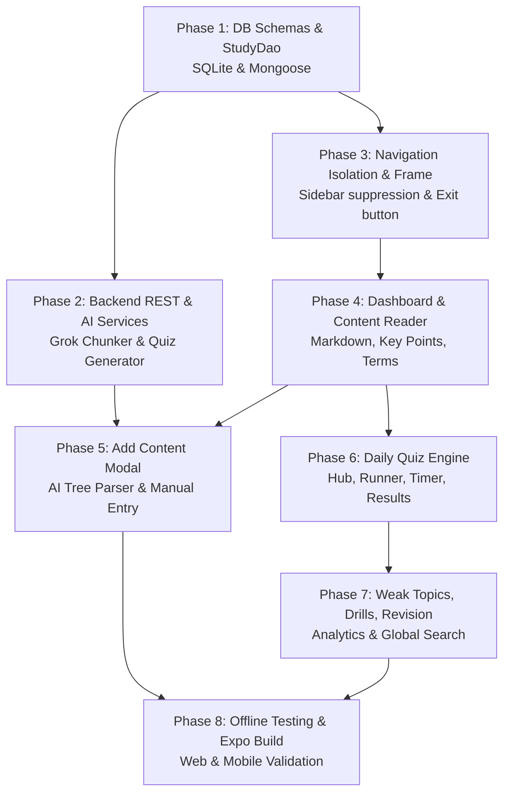

# Phased Implementation Roadmap: Smart Study Flow

## 1. Roadmap Overview & Dependency Graph

---

## 2. Detailed Phase Breakdown

### Phase 1: Database Schemas & Data Access Layer (Offline First)
- **Goal**: Establish the local SQLite tables and remote MongoDB Mongoose schemas for all 8 study entities.
- **Files to Modify/Create**:
  - `mobile-app/src/db/schema.js`: Add DDL for `study_subjects`, `study_chunks`, `study_quiz_questions`, `study_daily_quizzes`, `study_daily_quiz_attempts`, `study_daily_quiz_config`, `study_weak_questions`, `study_user_streaks`.
  - `mobile-app/src/db/StudyDao.js`: Implement complete CRUD, batch transactions, and outbox event enqueueing.
  - `mobile-app/server/models/`: Create `StudySubject.js`, `StudyChunk.js`, `StudyQuizQuestion.js`, `StudyDailyQuiz.js`, `StudyDailyQuizAttempt.js`, `StudyDailyQuizConfig.js`, `StudyWeakQuestion.js`, `StudyUserStreak.js`.
- **Deliverables**:
  - SQLite tables created on initialization.
  - CRUD operations verified via unit tests or script execution.

---

### Phase 2: Backend REST APIs & Grok AI Services
- **Goal**: Implement server endpoints and AI prompt pipelines for content organization and quiz generation.
- **Files to Create/Modify**:
  - `mobile-app/server/services/studyAiChunkerService.js`: Port the prompt from `chunk-content/index.ts` with verbatim preservation rules and tool-calling structured output using `GROK_API_KEY`.
  - `mobile-app/server/services/studyAiQuizService.js`: Port the prompt from `generate-daily-quiz/index.ts` to produce 4-option MCQs with explanations.
  - `mobile-app/server/routes/study.js`: Implement all `/api/study/*` endpoints.
  - `mobile-app/server/routes/sync.js`: Add study entities to bidirectional sync push/pull.
  - `mobile-app/server/index.js`: Mount `/api/study` router.
- **Deliverables**:
  - Tested endpoint for AI text parsing returning valid hierarchical study tree.
  - Tested endpoint for quiz generation returning valid questions.

---

### Phase 3: Navigation Isolation & Root Layout Frame
- **Goal**: Implement main sidebar suppression, top-level "Study Flow" item, and isolated Study workspace frame.
- **Files to Create/Modify**:
  - `mobile-app/src/components/SidebarDrawer.js`: Add "Study Flow" navigation item with `BookOpen` icon.
  - `mobile-app/App.js`: Add conditional branch: when `currentScreen === 'Study'`, hide main `SidebarDrawer` and render `StudyWorkspaceScreen`.
  - `mobile-app/src/screens/study/StudyWorkspaceScreen.js`: Main shell with top header containing `[← Exit to Dashboard]`, search trigger, and drawer toggle.
  - `mobile-app/src/components/study/StudySidebarDrawer.js`: Internal collapsible study tree navigator (Subjects, Chunks, Daily Quizzes, Settings).
- **Deliverables**:
  - Clicking "Study Flow" launches the isolated workspace where the main app sidebar is completely hidden.
  - Clicking "← Exit to Dashboard" seamlessly returns to the main app dashboard.

---

### Phase 4: Study Dashboard & Hierarchical Content Viewer
- **Goal**: Build the Study Dashboard and Chunk Reader with rich Markdown rendering and interactive tabs.
- **Files to Create**:
  - `mobile-app/src/screens/study/StudyDashboardScreen.js`: Hero banner, 4 stats cards, "Recently updated" chunk grid, and empty state.
  - `mobile-app/src/screens/study/StudyChunkReaderScreen.js`: Breadcrumbs, title editor, revision toggle, Notes markdown viewer, Key Points, Terms, Chunk Quiz, Next Chunk navigation.
  - `mobile-app/src/components/study/ChunkQuizTab.js`: MCQ quiz component for in-chunk practice.
- **Deliverables**:
  - Complete study notes reader matching `smart-study-flow` styling, with revision status toggling and next-chunk chaining.

---

### Phase 5: Add Content Modal (AI Chunker & Manual Mode)
- **Goal**: Implement content import workflow (ChatGPT raw paste, AI auto-organization, tree preview, manual chunk creation).
- **Files to Create**:
  - `mobile-app/src/components/study/AddContentModal.js`: 3-step modal (input, loading state, tree preview confirmation), mode switcher (Auto, Subject, Chunk, Manual).
- **Deliverables**:
  - Pasting a long text or syllabus correctly produces organized subjects, chapters, terms, and quizzes saved to SQLite and synced to the cloud.

---

### Phase 6: Daily Quiz Engine (Hub, Runner, Timer, Results)
- **Goal**: Build the complete daily quiz practice loop.
- **Files to Create**:
  - `mobile-app/src/screens/study/DailyQuizHubScreen.js`: Streak flame counter, 7-day activity dot graph, unattempted vs attempted tabs, history cards.
  - `mobile-app/src/screens/study/DailyQuizRunnerScreen.js`: Countdown timer, question palette, 4-option radio selector, auto-submit on timeout, manual submit.
  - `mobile-app/src/screens/study/DailyQuizResultScreen.js`: Grade badge (A+, A, B, C, D), percentage circle, time taken, question-by-question review with explanations.
  - `mobile-app/src/screens/study/DailyQuizSettingsScreen.js`: Config toggles (schedule time, difficulty, question count).
- **Deliverables**:
  - End-to-end quiz experience: start quiz -> countdown timer -> submit -> grade review -> streak increment.

---

### Phase 7: Weak Topics, Drills, Revision Reports & Global Search
- **Goal**: Provide targeted revision and global text search across all study assets.
- **Files to Create**:
  - `mobile-app/src/screens/study/WeakTopicsScreen.js`: Active vs Mastered tabs, grouped by subject, "⚡ Drill now" instant 20-Q quiz, "Mark as Mastered".
  - `mobile-app/src/screens/study/RevisionReportScreen.js`: Overall accuracy percentage, subject progress bars, mistake totals.
  - `mobile-app/src/screens/study/StudySearchScreen.js`: Real-time fuzzy text search across titles, summaries, notes, keypoints, terms, and questions.
  - `mobile-app/src/components/study/StudyQuickQuizModal.js`: Global quiz generation dialog.
- **Deliverables**:
  - Missed questions correctly appear in Weak Topics; drilling them creates a focused quiz; answering correctly twice marks them mastered.

---

### Phase 8: Expo Mobile/Web Verification & Production Build
- **Goal**: Verify responsive UI on mobile screens and desktop browsers, offline capabilities, and produce the web export.
- **Verification Steps**:
  1. Test offline mode in browser (Network: Offline) to ensure note reading, editing, and quiz solving work without network errors.
  2. Verify responsive layout on mobile viewport (drawer slide-over, sticky quiz controls).
  3. Run `npx expo export -p web` to update production `dist/` bundle.
  4. Ensure backend test suite passes and server logs show no uncaught exceptions.

